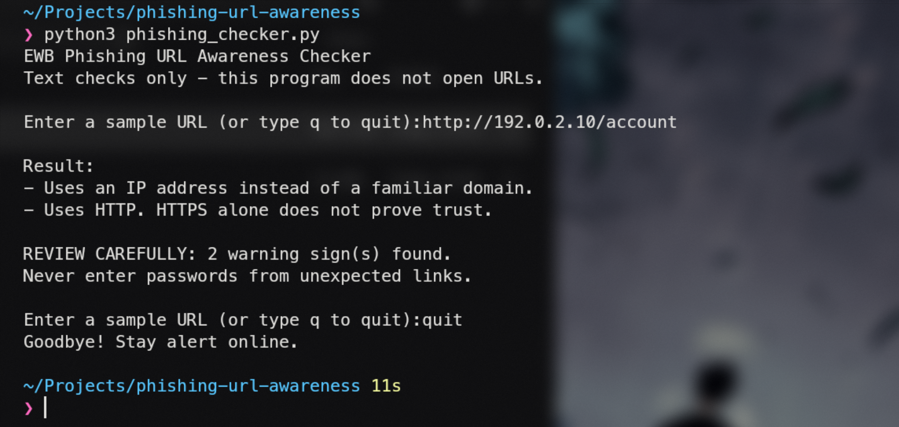
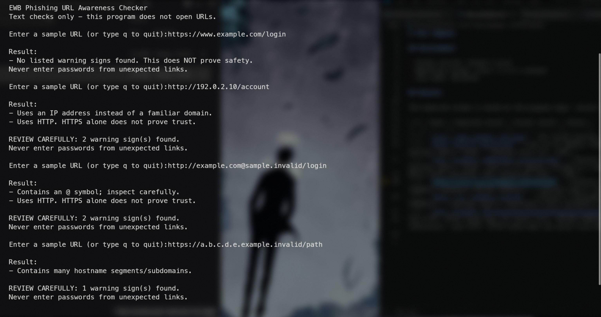

# EWB Phishing URL Awareness Checker

## Overview

Phishing is when someone sends a fake link or message to trick you into trusting it, usually so you will give away a password or other private details. I built this small Python program to read the text of a URL and point out a few simple warning signs. It never opens the link, so it is only a way to practice looking at URLs the way a defender would.

## Features

The program looks at one URL string at a time and runs six checks:

- It warns if the URL contains an `@` symbol.
- It warns if the URL is longer than 100 characters.
- It warns if the hostname is an IP address like `192.0.2.10`.
- It warns if the hostname has five or more dot-separated segments.
- It warns if the hostname contains `xn--`, which is the marker for punycode.
- It warns if the URL uses plain HTTP. If I type a URL with no scheme, the program adds `http://` itself, so that also gets this warning.

I also added three improvements. The program keeps asking for URLs until I type `q`, `quit` or `exit`. It prints a review summary only when real warning signs were found. And it handles text that is not a valid URL without crashing.

## Requirements

Python 3.10 or later. No extra packages are needed, because the program only uses the `re` module and `urlparse` from `urllib.parse`.

## How to Run

Python must be installed and available in the terminal. First open a terminal in the project root folder, `phishing-url-awareness`, so the terminal can find `phishing_checker.py`. Then run the command for your system.

Windows:

```text
python phishing_checker.py
```

macOS/Linux:

```text
python3 phishing_checker.py
```

Do not double-click the file. Run it from the terminal.

## Example Output

This is the output I expect when I enter the safe sample string `https://192.0.2.10/account`. It is an expected example written from the code, not a copy of a real run on my computer.

```text
EWB Phishing URL Awareness Checker
Text checks only - this program does not open URLs.

Enter a sample URL (or type q to quit):http://192.0.2.10/account

Result:
- Uses an IP address instead of a familiar domain.
- Uses HTTP. HTTPS alone does not prove trust.

REVIEW CAREFULLY: 2 warning sign(s) found.
Never enter passwords from unexpected links.

Enter a sample URL (or type q to quit):q
Goodbye! Stay alert online.
```

## Testing

I use five sample strings. The Expected column comes from the program logic. The Actual and Result columns stay pending until I run each input on my own computer and compare the output.

| # | Input | Expected | Actual | Result |
|---|-------|----------|--------|--------|
| 1 | `https://www.example.com/login` | No listed warning signs found. This does NOT prove safety. No review summary. |No listed warning signs found. This does NOT prove safety. Never enter passwords from unexpected links.| PASS |
| 2 | `http://192.0.2.10/account` | Uses an IP address instead of a familiar domain. Then: Uses HTTP. HTTPS alone does not prove trust. Summary: REVIEW CAREFULLY: 2 warning sign(s) found. | - Uses an IP address instead of a familiar domain.- Uses HTTP. HTTPS alone does not prove trust.REVIEW CAREFULLY: 2 warning sign(s) found. Never enter passwords from unexpected links. | PASS |
| 3 | `http://example.com@sample.invalid/login` | Contains an @ symbol; inspect carefully. Then: Uses HTTP. HTTPS alone does not prove trust. Summary: REVIEW CAREFULLY: 2 warning sign(s) found. |Uses an IP address instead of a familiar domain. Uses HTTP. HTTPS alone does not prove trust. REVIEW CAREFULLY: 2 warning sign(s) found. Never enter passwords from unexpected links. | PASS |
| 4 | `https://a.b.c.d.e.example.invalid/path` | Contains many hostname segments/subdomains. Summary: REVIEW CAREFULLY: 1 warning sign(s) found. | Contains many hostname segments/subdomains.REVIEW CAREFULLY: 1 warning sign(s) found. Never enter passwords from unexpected links. | PASS |
| 5 | `https://xn--example.invalid/` | Contains a punycode-style hostname. Summary: REVIEW CAREFULLY: 1 warning sign(s) found. | Contains a punycode-style hostname.REVIEW CAREFULLY: 1 warning sign(s) found.Never enter passwords from unexpected links. | PASS |

The detailed testing record is in `tests/test_samples.md`.

## Screenshots

The first screenshot is meant to show the program running from the project folder with the sample `http://192.0.2.10/account`, including both warnings and the summary.



The second screenshot is meant to show the results of four tests, either from the filled-in test record or from the terminal.



## Improvements

**Repeat inspections and quit commands.** Before this change the program would stop after one URL. Now `main()` uses a `while True` loop, and typing `q`, `quit` or `exit` prints a goodbye line and ends the loop. This saves restarting the program for every sample. To check it, I run the program, enter two samples one after the other, then type `q`.

**Warnings versus information messages.** Some results are not warnings, such as empty input or "No listed warning signs found." The helper `has_warnings` looks at the first finding and decides if it is a real warning, so the review summary only appears when it should. To check it, I compare test 1, which should print no summary, with test 2, which should print the two-warning summary.

**Malformed input.** Text like `http://[bad` makes `urlparse` raise a `ValueError`. One `try/except ValueError` catches it and the program prints "This text is not a valid URL format." instead of a traceback. To check it, I type `http://[bad` and confirm the program does not crash and prints no summary.

After testing, I should add my own real observations here, such as anything that surprised me or any mistake I actually made and fixed.

## Limitations

This is an educational tool. It only reads URL text. It does not visit URLs, scan for malware or prove that a URL is safe. No warning signs found does NOT mean a URL is safe.

For example, `https://secure-login.example.invalid` gets no warnings from these six checks, even though a name like that could be misleading. The checks are simple on purpose, and a real attacker can avoid all of them.

## Ethical Use

Use sample strings only. Do not collect credentials. Do not use this project to deceive anyone or to test websites without permission.

This project is for defensive learning. I should never open a suspicious link just to test it, and I should only use the sample strings listed in this README.

## Author

- Name: [Utthan Bhat]
- Batch or course: [Ewb AI POWERED CYBERSECURITY INTERNSHIP]
- GitHub username: [bhatutthan]
- Repository URL: []
- Submission date: [DATE]